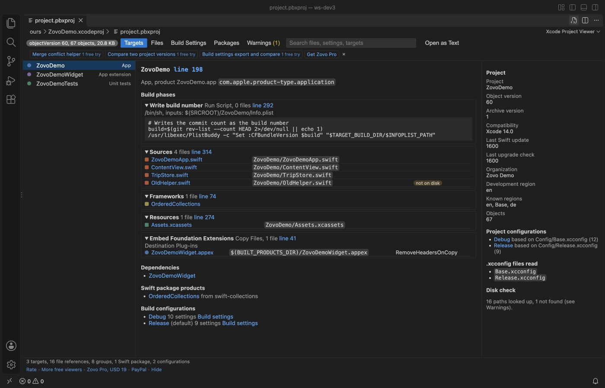

# Xcode Project Viewer (pbxproj)

Open an Xcode project.pbxproj in VS Code as a project: targets, build phases, files and groups, build settings and Swift packages, not thousands of lines of ids. Made by Zovo.

Free, with no account and no network calls:

- Targets with their build phases: sources, resources, frameworks, copy files (with the destination) and run script phases (with the script text). Dependencies, Swift package products, synchronized folders and build configurations are listed for each target.
- The file and group tree as the project navigator shows it, with each file's path from the project folder and the targets that build it.
- A build settings table for any target and configuration. Each row says where the value is set (target, project or an .xcconfig file), and $(inherited) is resolved from the level below.
- Swift packages: location, version rule and the products each target uses.
- Warnings for broken references: objects that point to removed ids, objects defined twice, entries listed twice, and files or folders that are missing on disk.
- Search the open tab by file name, setting name or value, package or warning text. A click on any line link opens that line in the text editor beside the viewer.
- Read-only. The text editor stays the default for project.pbxproj, so merges and edits work as before. It works the same on macOS, Linux and Windows, with no Xcode installed.

Zovo Pro: USD 19 once, for the Pro tools in every Zovo extension. Each Pro tool has 1 free try on your computer first:

- Merge conflict helper: after a git merge, it resolves the conflict blocks in project.pbxproj. New files and targets from both sides are kept, and you pick the side for settings changed on both. It also removes objects defined twice, entries listed twice and references to missing objects. Every change shows in a diff (the current file beside the fixed one), and nothing is written until you click Apply and Save. The id comments stay in place.
- Compare two project versions: targets, files, groups, target membership, build settings, Swift packages and dependencies compared by object, not by text line. Save the report as Markdown for a pull request.
- Build settings export and compare: save every build setting of every target and configuration as CSV or Markdown, or compare two targets side by side.

## How to use it

- Open project.pbxproj (inside the .xcodeproj folder) and click the Open Xcode Project Viewer button at the top right of the text editor. You can also right-click the file or the .xcodeproj folder in the Explorer, or use Open With.
- Use the tabs at the top: Targets, Files, Build Settings, Packages and Warnings. Type in the search box to filter the open tab.
- In Build Settings, pick a target (or Project) and a configuration. "Only settings set on the target" hides the values that come from the project level.
- Open as Text in the toolbar goes back to the text editor.
- To try it without your own project, run Xcode Project: Open the Sample Project from the Command Palette.
- The Pro tools are in the Command Palette (Xcode Project: ... (Pro)), in the Explorer right-click menu, in the editor title menu and in the small row at the end of the viewer toolbar. The row closes with its x for the rest of the session, and the setting `xcodeProj.showProTools` hides the Pro tools for good.

## What the viewer reads

The viewer reads the project file and the .xcconfig files its configurations are based on (with their #include lines). It does not know Xcode's own SDK defaults, so a setting that nobody set in the project or an .xcconfig file is not listed.

The disk check looks up every file and folder path of the project, relative to the folder that holds the .xcodeproj. A project.pbxproj that is not inside a .xcodeproj folder still opens, but the disk check is skipped because the paths would be wrong.

A file with merge conflict markers gets a short note with the conflict blocks and their lines, and buttons for the Merge conflict helper and Open as Text. A file that is not an Xcode project, or that has a syntax error, gets a note that names the line. The viewer never switches the tab to another editor by itself.

## Privacy

The extension reads the files you open and nothing else. It makes no network calls, and nothing is uploaded or measured. The Pro tools write only the files you ask for, and the merge fix changes the project file only after you click Apply and Save. The links at the bottom of the viewer (Rate, More free tools, Zovo Pro) open a page only when you click them, and the setting `xcodeProj.showSupportLinks` hides them.

## Settings

| Setting | Default | What it does |
|---|---|---|
| `xcodeProj.showProTools` | true | Shows the Pro tools in menus, the palette and the toolbar row. |
| `xcodeProj.showSupportLinks` | true | Shows the Rate, More free tools and Zovo Pro links. |
| `xcodeProj.askForRating` | true | Asks once for a rating after two good uses at least 30 minutes apart. |

## Zovo Pro

One payment of USD 19 unlocks the Pro tools in every Zovo extension on your computers; a team of 5 is USD 59. The key works offline. Run Zovo Pro: Get Zovo Pro from the Command Palette. The Zovo Pro tab lists this extension's Pro tools and your free tries before any payment page opens.
